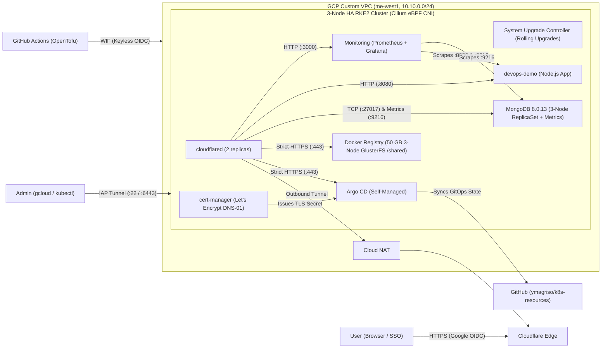

# High Availability RKE2 Cluster on Google Cloud (GitOps, OpenTofu & Free Trial Setup)

This repository contains the configuration, GitOps manifests, OpenTofu infrastructure-as-code declarations, and step-by-step documentation for deploying a highly available, 3-node **RKE2 (Kubernetes)** cluster on **Google Cloud Platform (GCP)**.

The architecture is optimized to run within the **$300 GCP Free Trial** by provisioning private VMs (`--network-interface=no-address`) in a dedicated **Custom VPC**, using **Identity-Aware Proxy (IAP)** for administrative access, **Cloud NAT** for outbound internet, **Cilium** (eBPF) as the CNI, **`cert-manager`** (Let's Encrypt DNS-01) for automated HTTPS certificates, and **self-managed Argo CD** exposed via **Cloudflare Tunnel (`cloudflared`)** with **Google OIDC** authentication.

---

## Architecture Overview



---

## Why Two Separate Repositories

This setup splits application code ([`ymagriso/sample-nodejs`](https://github.com/ymagriso/sample-nodejs)) from cluster infrastructure and GitOps state (`ymagriso/k8s-resources`) for four reasons:

- **Clear Ownership**: `sample-nodejs` holds application code, container builds, and the `devops-demo` Helm chart. `k8s-resources` holds OpenTofu stacks, cluster bootstrap scripts, and Argo CD manifests.
- **Independent Triggers**: Application changes never trigger `tofu-apply.yml` or clutter infrastructure history. Cluster changes never run Node.js builds or image pushes.
- **Least-Privilege Security**: `sample-nodejs` CI holds only OCI registry credentials and `K8S_RESOURCES_DEPLOY_KEY` to update [devops-demo.yaml](argocd/apps/devops-demo.yaml). It holds no GCP, Cloudflare, or cluster-admin access.
- **Clean Release Handoff**: `sample-nodejs` pushes immutable OCI image and chart artifacts first, then bumps `targetRevision` and `image.tag` in [devops-demo.yaml](argocd/apps/devops-demo.yaml) for Argo CD.

---

## Documentation Guides

| # | Guide | Description |
| :--- | :--- | :--- |
| **1** | [**Architecture & Regional Cost Comparison**](docs/01-architecture-and-costs.md) | Why **RKE2** and **Cilium CNI** were chosen, **Single vs. Multiple Namespace** strategy (pros/cons & recommendations), GCP "Always Free" vs. $300 Free Trial credits, and regional cost/latency comparison (`me-west1` vs. US/EU). |
| **2** | [**GCP Infrastructure & RKE2 Cluster Setup**](docs/02-gcp-rke2-cluster-setup.md) | Automated provisioning with **OpenTofu** & **GitHub Actions** (Dedicated Custom VPC, Cloud NAT, IAP firewalls, fixed node IPs, and automated RKE2 + Cilium bootstrap) alongside manual `gcloud` walkthrough. |
| **3** | [**`cert-manager` & Let's Encrypt (HTTPS)**](docs/03-cert-manager-letsencrypt.md) | Installing `cert-manager` via Helm and configuring `letsencrypt-staging` and `letsencrypt-prod` `ClusterIssuer` resources using Cloudflare DNS-01. |
| **4** | [**Argo CD GitOps, Cloudflare Tunnel & Google OIDC**](docs/04-argocd-cloudflare-oidc.md) | Deploying Argo CD, issuing its Let's Encrypt certificate, exposing it via Cloudflare Tunnel (`cloudflared`), bootstrapping the Root App-of-Apps, and enabling Google OIDC login. |
| **5** | [**MongoDB ReplicaSet (`8.0.13`) & Prometheus Metrics**](docs/05-mongodb-replicaset-and-metrics.md) | Deploying a 3-node Bitnami MongoDB `8.0.13` ReplicaSet via Argo CD with explicit resource limits, Prometheus metrics exporter (`:9216`), and external access via Cloudflare Tunnel (`:27017`). |
| **6** | [**Cluster Operations, Renovate & Cost Management**](docs/06-operations-and-cleanup.md) | Automated Helm, Docker & OpenTofu updates with **Mend Renovate**, **Trivy** container image & IaC vulnerability scanning, zero-downtime rolling RKE2 upgrades via **System Upgrade Controller (SUC)**, automated nightly VM power management (`23:00–06:00`), and single-click teardown. |

---

## Repository Structure

```text
k8s-resources/
├── README.md                                 # Overview, architecture, and guide index
├── renovate.json                             # Mend Renovate configuration
├── .github/
│   ├── scripts/                              # Cluster bootstrap, OpenTofu guards, and Trivy helpers
│   └── workflows/                            # OpenTofu, VM power, and Trivy CI workflows
├── tofu/                                     # GCP OpenTofu infrastructure stack
│   └── cloudflare/                           # Cloudflare Tunnel and DNS OpenTofu stack
├── docs/                                     # Step-by-step architecture and operations guides
├── cert-manager/                             # Helm values and Let's Encrypt ClusterIssuers
└── argocd/                                   # Argo CD values and TLS certificates
    ├── bootstrap/                            # Root App-of-Apps manifest
    └── apps/                                 # Child Argo CD Application definitions
        └── workloads/                        # Workload manifests and Kustomize bases
            ├── cloudflared/                  # Cloudflare Tunnel daemon
            ├── docker-registry/              # Private OCI and Docker Registry
            ├── mongodb/                      # MongoDB ReplicaSet and metrics exporter
            ├── monitoring/                   # Prometheus and Grafana dashboards
            ├── system-upgrade-controller/    # Rancher System Upgrade Controller
            └── rke2-upgrade-plans/           # RKE2 server and agent upgrade plans
```
